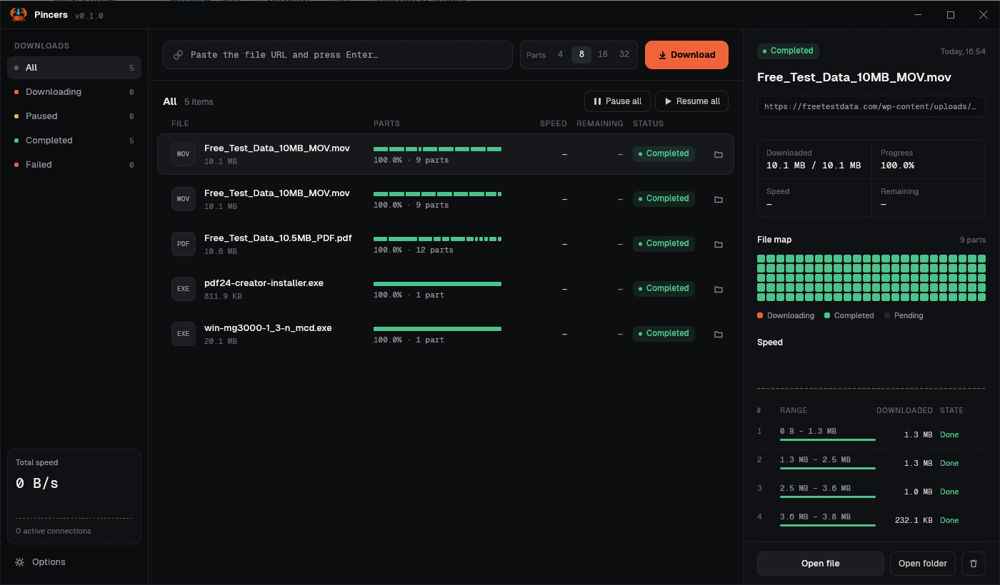
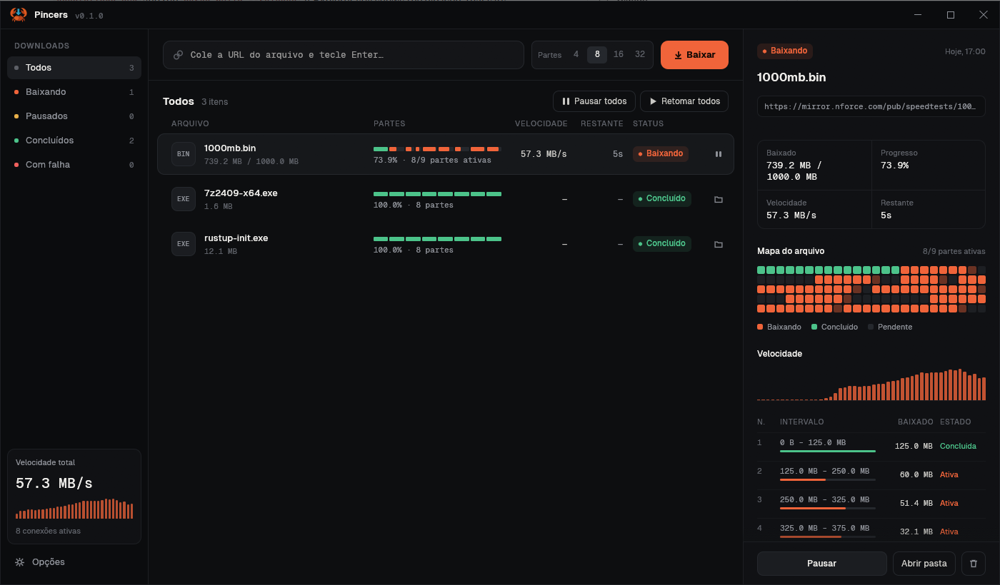
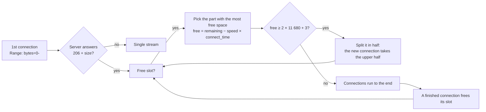

<p align="center">
  
</p>

<h1 align="center">Pincers</h1>

<p align="center">
  <strong>A blazing-fast, multi-connection download manager — written in Rust 🦀</strong><br>
  It grabs every file with several pincers at once.
</p>

<p align="center">
  
  
  
  
  
</p>

<p align="center">
  <a href="#-features">Features</a> ·
  <a href="#-how-it-works">How it works</a> ·
  <a href="#-getting-started">Getting started</a> ·
  <a href="#-browser-extension">Browser extension</a> ·
  <a href="#-translations">Translations</a> ·
  <a href="#%EF%B8%8F-project-layout">Project layout</a>
</p>

<p align="center">
  
  
</p>

---

**Pincers** splits each download into parts and fetches them over several HTTP
connections at the same time, the way **Internet Download Manager** does. Its
segmentation engine was rebuilt from the reverse engineering of `IDMan.exe`:
the same rules for choosing which part to split, when to open another
connection and how to stitch the parts together, reimplemented from scratch
in safe, async **Rust**. *(Pincers? A crab's claws. Ferris would approve.)*

## ✨ Features

- **Dynamic segmentation, IDM-style.** Up to 32 connections per file
  (8 by default). When a connection finishes, it immediately splits the largest
  remaining part, so every connection stays busy until the last byte.
- **Resume anywhere.** Pause, close the app, pull the plug: progress is
  saved every second and the download continues where it stopped.
  `If-Range` makes sure the file didn't change on the server meanwhile.
- **No "assembling file…" step.** Every connection writes straight into one
  preallocated file, so the download is done the moment the last byte arrives.
- **Plays nice with servers.** Retries with back-off, restarts stalled
  connections, falls back to a single connection when ranges aren't supported,
  and backs off to the number of connections a server accepts (HTTP 429/503).
- **Data-integrity checks.** Neighbouring connections must agree on 64
  overlapping bytes at each boundary; on a mismatch Pincers restarts on one
  connection instead of saving a corrupt file.
- **Speed limiter** shared fairly by all connections.
- **A proper desktop app.** Dark theme designed with Claude Design, Geist
  fonts, custom title bar, per-part progress bars, a live file map, speed
  charts and a parts table, all in a single native executable built with egui.
- **Browser integration** for Opera GX, Chrome and Firefox (see below).
- **Speaks your language.** Every text comes from an XML file: Portuguese and
  English are built in, and new languages can be added without recompiling.
- **CLI included** for scripts and terminals.

## 🔧 How it works



The rules come straight from IDM's own code (`ChunksList::FindMaxFreeChunk`,
`NeedNewConnection`, `HTTPConnection::GetTempEndPos`…):

1. The first connection asks for `bytes=0-` and keeps downloading. Its answer
   tells the size and whether the server supports ranges.
2. The **free space** of a part is what is left to download *minus what its
   connection will still fetch while a new connection is being established*.
   The part with the most free space is split in half.
3. Parts smaller than **11 680 bytes** (8 TCP segments of 1 460 bytes) are never split.
4. A connection that reaches its end keeps going and **absorbs the next part**
   if that one has received fewer than 51 bytes. Otherwise it verifies 64 bytes
   of overlap with its neighbour and stops.

The whole investigation, with addresses, decompiled snippets and what Pincers
does differently, is in **[docs/IDM_ANALYSIS.md](docs/IDM_ANALYSIS.md)**.

### Some numbers

Measured on the same machine and connection, same files, against `curl`:

| File | curl (1 connection) | Pincers (8 connections) |
|---|---|---|
| 50 MB, far-away server | 14.6 s | **7.2 s** |
| 100 MB, Hetzner Ashburn | 5.5 s | **4.4 s** |

Every test file came out byte-for-byte identical to `curl`'s copy (SHA-256),
including downloads that were killed halfway and resumed.

## 🚀 Getting started

You need [Rust](https://rustup.rs) (stable, edition 2024) and, on Windows, the
Windows SDK's `rc.exe` (installed with Visual Studio Build Tools), used to
embed the icon.

```bash
git clone https://github.com/dazevedogabriel/Pincers.git pincers
cd pincers
cargo build --release
```

### Desktop app

Double-click `target/release/pincers.exe`, or start it with links to download:

```bash
target/release/pincers.exe gui https://example.com/big-file.iso
```

Paste one or more links into the bar and press **Enter**. Pincers runs as a
single instance: opening it again just brings the window to the front (and
hands over any links you passed).

### Command line

```bash
target/release/pincers.exe https://example.com/big-file.iso -c 16 -o D:\Downloads -l 5M
```

| Option | Meaning |
|---|---|
| `-c, --connections` | maximum connections (default 8, like IDM) |
| `-o, --output` | destination folder |
| `-l, --limit` | speed limit, e.g. `500K`, `2M` |
| `Ctrl+C` | pause; run the same command again to resume |

## 🧩 Browser extension

The browser extension lives in its own repository:
**[pincers-extension](https://github.com/dazevedogabriel/pincers-extension)**
(Opera GX, Chrome and Firefox). Like IDM's *Integration Module*, it catches
the browser's downloads and hands them to Pincers, starting it if it is closed.

There is nothing to install or add to PATH on this side: browsers can only
start a program they find in the registry, so every time the Pincers window
opens it registers its *current* location (`HKCU`, no admin rights). Move
`pincers.exe` anywhere, open it once, and the extension follows it.
`pincers register` does the same from a terminal; `pincers unregister` removes
the entries. The extension's IDs live in [`src/bridge.rs`](src/bridge.rs).

## 🌍 Translations

Every text Pincers shows (window, status messages, errors and `--help`) comes from
[`locales/`](locales): **Português (Brasil)** and **English** ship inside the
executable. Pick one in **Opções → Idioma**, or leave it on *Automático* to follow
the Windows language. The change applies at once, even to running downloads.

Adding a language takes no compiler:

1. Copy [`locales/en.xml`](locales/en.xml) and change `code` and `name`:
   ```xml
   <language code="es" name="Español">
     <string key="bar.download">Descargar</string>
     <plural key="list.count"><one>{n} elemento</one><other>{n} elementos</other></plural>
   </language>
   ```
2. Translate the text between the tags. Keep each `key` and every `{placeholder}`;
   `<plural>` takes `<one>` (for 1) and `<other>`.
3. Save it as `es.xml` in `%APPDATA%\Pincers\locales\` (or in a `locales` folder
   next to `pincers.exe`) and reopen Pincers. It shows up in the language menu.

Missing keys fall back to English, then Portuguese, so a partial translation still
works. A file with the code of a built-in language overrides just the keys it has.
To ship a language in the executable, add the file to `locales/` and to `BUILT_IN`
in [`src/i18n.rs`](src/i18n.rs); `cargo test` then checks it has every key the code uses.

The [browser extension](https://github.com/dazevedogabriel/pincers-extension#-translations)
is translated separately, in the browsers' standard `messages.json` format.

## 🗂️ Project layout

```text
pincers/
├── src/
│   ├── main.rs        CLI entry point, single-instance hand-off
│   ├── engine.rs      scheduler + connections (IDM's Session / Connection)
│   ├── chunks.rs      segment bookkeeping (IDM's ChunksList)
│   ├── probe.rs       first request: size, ranges, file name
│   ├── limiter.rs     fair token-bucket speed limiter
│   ├── state.rs       resume state (.pincers files)
│   ├── bridge.rs      local IPC + native-messaging host for browsers
│   ├── i18n.rs        translations loaded from locales/*.xml
│   └── gui/           egui window: theme, views, title bar
├── locales/           pt-BR.xml and en.xml: every text the program shows
├── assets/            logo.svg (also the .exe icon) and Geist fonts
├── docs/              reverse-engineering notes and screenshots
├── examples/          extension_icons: renders the extension's icons from the logo
└── build.rs           turns assets/logo.svg into the Windows icon
```

Want a different icon? Replace `assets/logo.svg` and run `cargo build --release`.
The executable, window and taskbar icons are regenerated from it.

## 🙏 Credits

- [Geist and Geist Mono](https://vercel.com/font) by Vercel, under the SIL Open Font License.
- Built on [tokio](https://tokio.rs), [reqwest](https://github.com/seanmonstar/reqwest),
  [egui/eframe](https://github.com/emilk/egui), [resvg](https://github.com/linebender/resvg) and [clap](https://github.com/clap-rs/clap).
- Internet Download Manager is a product of Tonec FZE. Pincers is an
  independent project, not affiliated with or endorsed by Tonec. Its code was
  written from scratch after studying how IDM behaves; no IDM code is included.

<p align="center"><sub>Made with 🦀 and a lot of <code>cargo build --release</code>.</sub></p>
